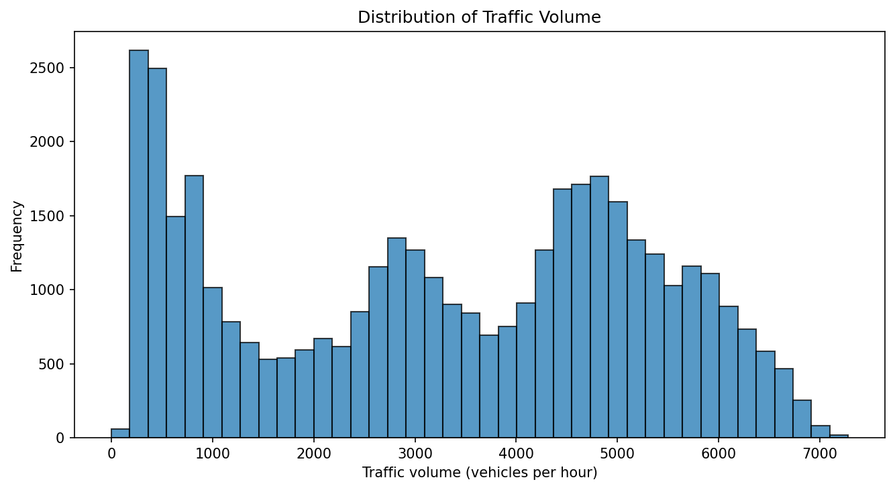
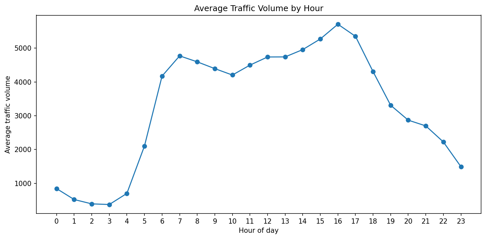
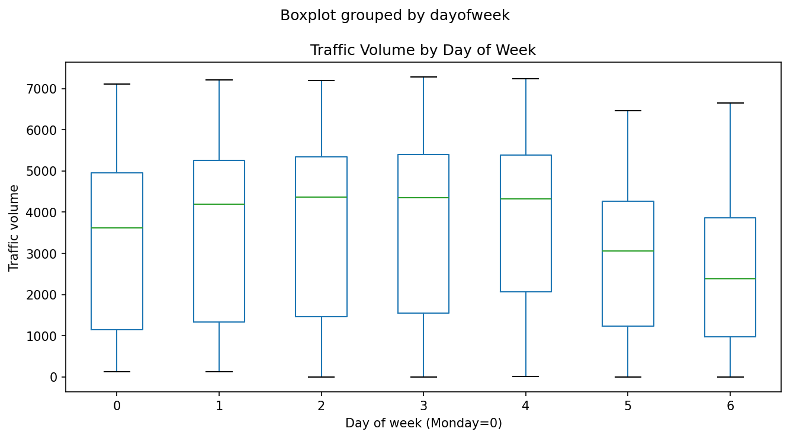
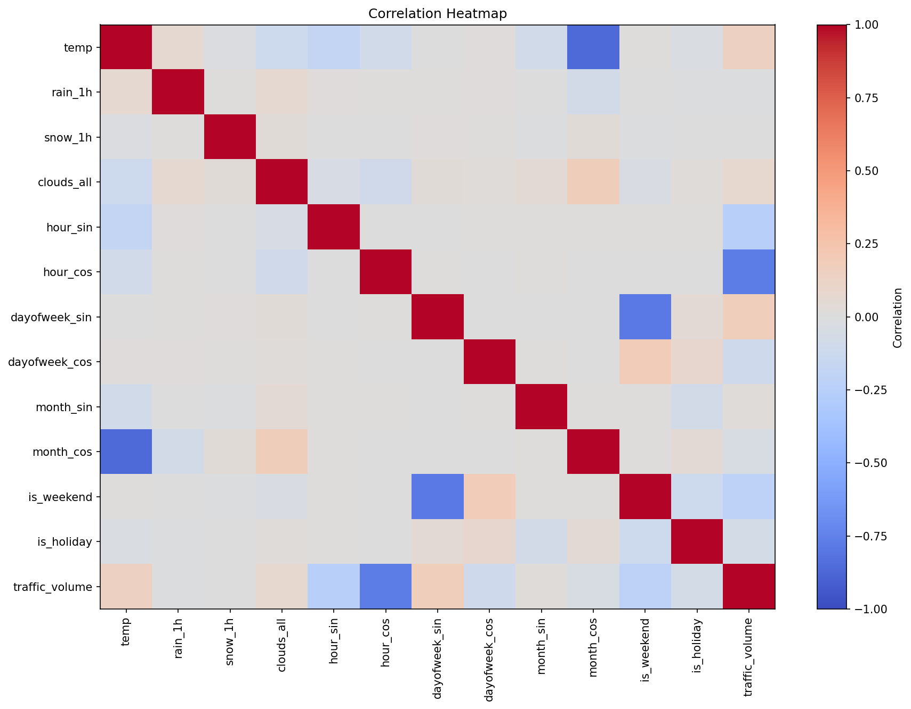
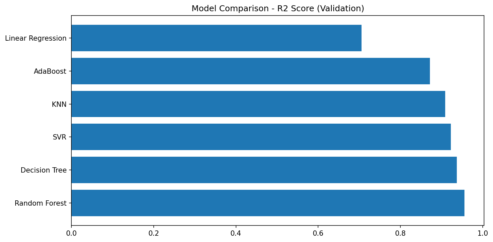
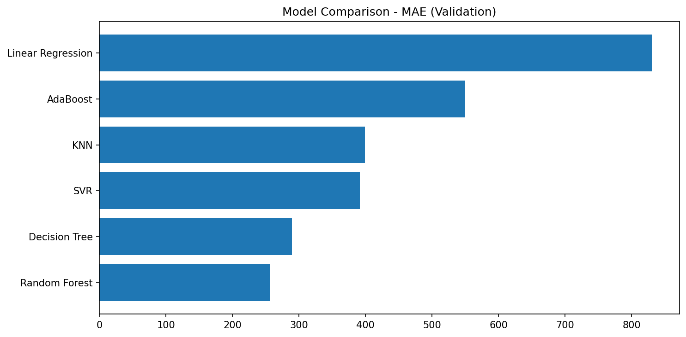
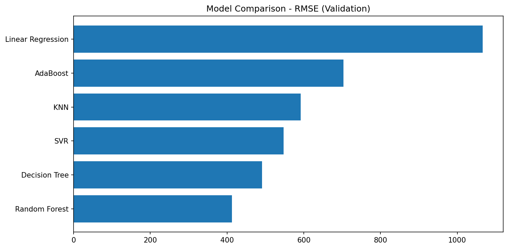
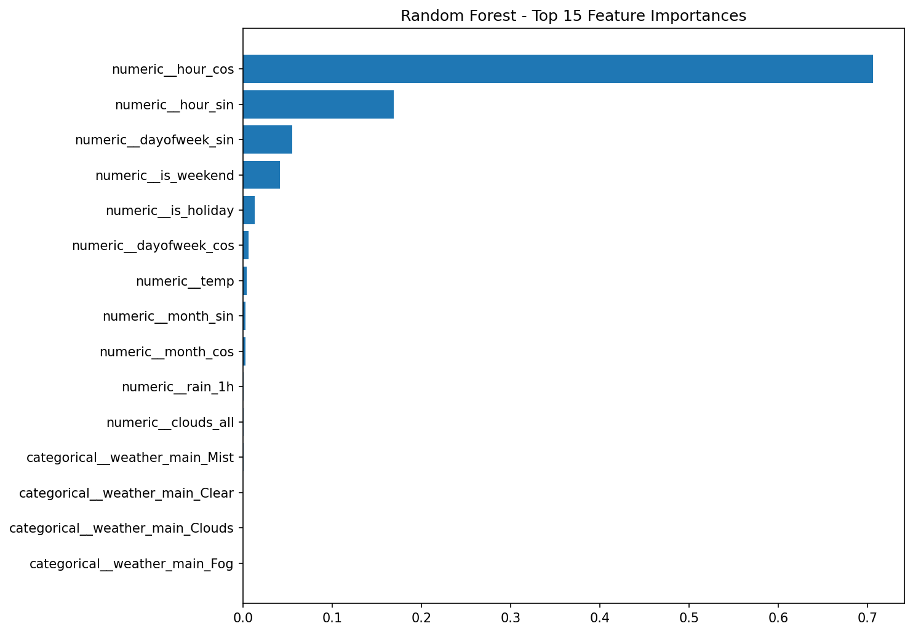

# Traffic Prediction Using Machine Learning

## Project Overview

This project predicts hourly traffic volume on westbound Interstate 94 (I-94) between Minneapolis and St. Paul, Minnesota, using regression models. It uses historical traffic, weather, calendar, and holiday information from October 2012 to September 2018.

The target variable is `traffic_volume`, measured in vehicles per hour.

## Dataset

- **Name:** Metro Interstate Traffic Volume
- **Source:** [UCI Machine Learning Repository](https://archive.ics.uci.edu/dataset/492/metro+interstate+traffic+volume)
- **Original size:** 48,204 rows and 9 columns
- **Time period:** October 2012 – September 2018

Place `Metro_Interstate_Traffic_Volume.csv` in the project root, beside the notebook.

## Project Workflow

1. Load the dataset using a relative file path.
2. Remove exact duplicate rows and inspect data quality.
3. Remove physically invalid temperature values (`temp <= 0`) and the extreme rainfall outlier (`rain_1h >= 1000`).
4. Consolidate repeated timestamps into one hourly observation.
5. Engineer calendar features and cyclical encodings for hour, day of week, and month.
6. Explore traffic distributions and temporal patterns.
7. Split the data chronologically into training, validation, and test sets.
8. Train and compare regression models.
9. Evaluate feature importance and export the comparison results.

### Duplicate Timestamp Handling

The original dataset contains repeated timestamps. After removing 17 exact duplicate rows, a further 7,612 rows were consolidated because multiple records represented the same timestamp. Within each timestamp group, the traffic-volume target is identical. Numerical weather measurements are averaged, and the most frequent `weather_main` category is retained.

After the data-quality filters and timestamp aggregation, the modeling dataset contains **40,564 hourly observations**. The source does not guarantee a fully continuous hourly sequence, so gaps may remain.

## Exploratory Data Analysis

### Traffic Volume Distribution



### Average Traffic by Hour



### Traffic by Day of Week



### Correlation Heatmap



## Feature Engineering and Preprocessing

- Extracted `hour`, `dayofweek`, `month`, and `is_weekend`.
- Generalized holiday dates into an `is_holiday` indicator.
- Encoded cyclical time features using sine and cosine transformations:
  - `hour_sin`, `hour_cos`
  - `dayofweek_sin`, `dayofweek_cos`
  - `month_sin`, `month_cos`
- One-hot encoded `weather_main` to avoid imposing an artificial numeric order on weather categories.
- Applied `StandardScaler` to numeric features for Linear Regression, KNN, and SVR within model pipelines.
- Used chronological splitting to preserve time order and avoid training on future observations.

### Data Split

| Split | Rows | Share |
|---|---:|---:|
| Training | 28,394 | 70% |
| Validation | 6,085 | 15% |
| Test | 6,085 | 15% |

## Machine Learning Models

The notebook trains and evaluates:

- Linear Regression
- Random Forest Regressor
- Decision Tree Regressor
- K-Nearest Neighbors (KNN)
- Support Vector Regression (SVR)
- AdaBoost Regressor
- Time-aware Stacking Regressor

The stacking implementation uses expanding-window `TimeSeriesSplit` out-of-fold predictions, so each meta-model training prediction is generated by base models trained only on earlier observations.

## Model Evaluation

Models are evaluated using:

- **MAE (Mean Absolute Error):** Average absolute prediction error.
- **RMSE (Root Mean Squared Error):** Penalizes larger prediction errors more strongly.
- **R² Score:** Measures the proportion of target variance explained by the model.

### Validation Results

The validation set is used for model comparison and selection.

| Model | MAE | RMSE | R² Score |
|---|---:|---:|---:|
| Random Forest | 256.18 | 412.68 | 0.9559 |
| Time-aware Stacking | 269.20 | 423.49 | 0.9536 |
| Decision Tree | 289.22 | 491.49 | 0.9375 |
| SVR | 391.61 | 547.19 | 0.9225 |
| KNN | 399.51 | 592.42 | 0.9092 |
| AdaBoost | 550.07 | 703.34 | 0.8720 |
| Linear Regression | 830.28 | 1066.24 | 0.7058 |

### Test Results

The test set is reserved for final evaluation and is not used to select or tune the model.

| Model | MAE | RMSE | R² Score |
|---|---:|---:|---:|
| Linear Regression | 831.57 | 1059.34 | 0.7136 |
| Random Forest | 240.55 | 388.14 | 0.9615 |
| KNN | 390.25 | 589.07 | 0.9114 |
| Decision Tree | 273.66 | 480.40 | 0.9411 |
| SVR | 381.88 | 529.11 | 0.9285 |
| AdaBoost | 542.49 | 695.37 | 0.8766 |
| Time-aware Stacking | 243.82 | 386.58 | 0.9619 |

### Model Comparison







## Key Findings

- **Random Forest is the preferred model based on validation performance.** It achieved a validation R² of 0.9559 and outperformed the time-aware stacking model on validation MAE, RMSE, and R².
- **Random Forest and Stacking have very similar test performance.** Stacking has a marginally higher test R² (0.9619 vs. 0.9615) and slightly lower RMSE, while Random Forest has lower MAE. The small difference does not establish a meaningful overall advantage for Stacking.
- **Time of day is the dominant feature in the fitted Random Forest.** The combined importance of `hour_sin` and `hour_cos` is approximately 87.42%.
- **Weather category has very low importance in this fitted model.** The combined importance of the one-hot `weather_main` categories is approximately 0.05%. This is a model-specific predictive finding, not evidence that weather has no real-world effect.
- The cyclical representation of time substantially improves the linear model compared with treating the hour as an ordinary linear numeric feature.

### Feature Importance



## Technologies Used

- Python
- Pandas
- NumPy
- Matplotlib
- Scikit-learn
- Jupyter Notebook

## How to Run

1. Clone or download this repository.
2. Make sure the CSV file is in the project root, beside the notebook.
3. Install the required packages:

   ```bash
   pip install pandas numpy matplotlib scikit-learn jupyter
   ```

4. Start Jupyter:

   ```bash
   jupyter notebook
   ```

5. Open `traffic_prediction_improved.ipynb` and run the cells from top to bottom.

The notebook saves EDA and model-comparison plots in the `images/` folder and exports the evaluation table to `all_models_comparison.csv`.

## Limitations

- The dataset represents one highway direction and location; results may not generalize to other roads or regions.
- Multiple weather observations can exist for the same timestamp. This notebook averages numerical weather measurements and uses the most frequent weather category when consolidating those records.
- The source is not a perfectly continuous hourly time series. The notebook does not create lag features, and remaining time gaps should be addressed before building sequence-based forecasting models.
- SVR with an RBF kernel is trained on a reproducible sample of 6,000 training rows for computational practicality. Its results are therefore not from a full-training-set SVR fit.
- The model configurations are specified in the notebook; an exhaustive automated hyperparameter search has not been performed.
- Random Forest feature importance is model-specific and does not imply causation.
- The final model choice is based on validation performance. The test set should remain reserved for final evaluation rather than repeated tuning.

## Conclusion

The experiments show that tree-based models provide strong traffic-volume predictions for this dataset. Random Forest is the preferred model based on validation results, while the time-aware Stacking model performs similarly on the held-out test set. Cyclical time features are especially informative, whereas the weather-category features contribute relatively little to the fitted Random Forest's predictions.
